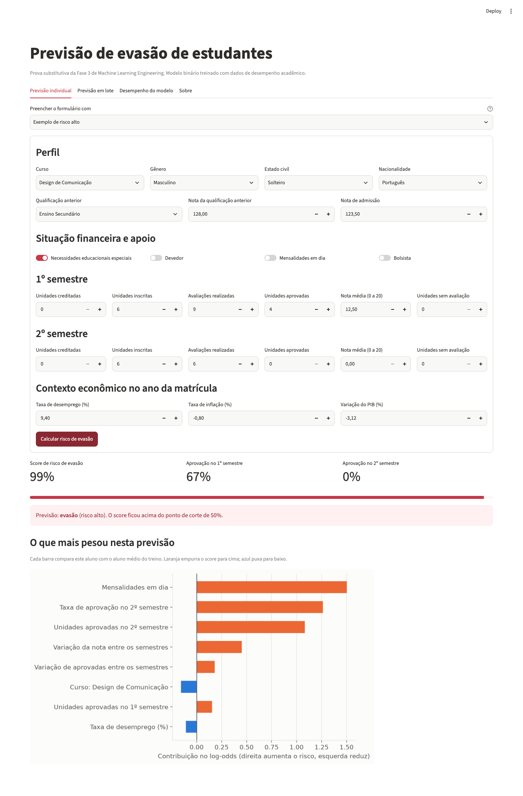
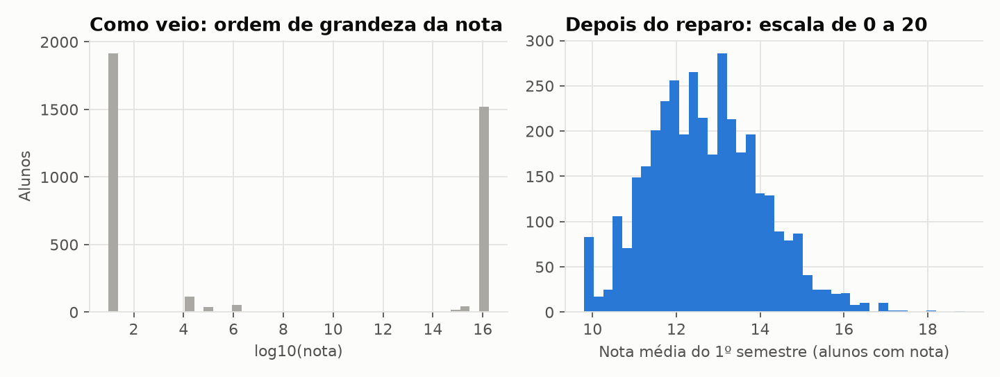
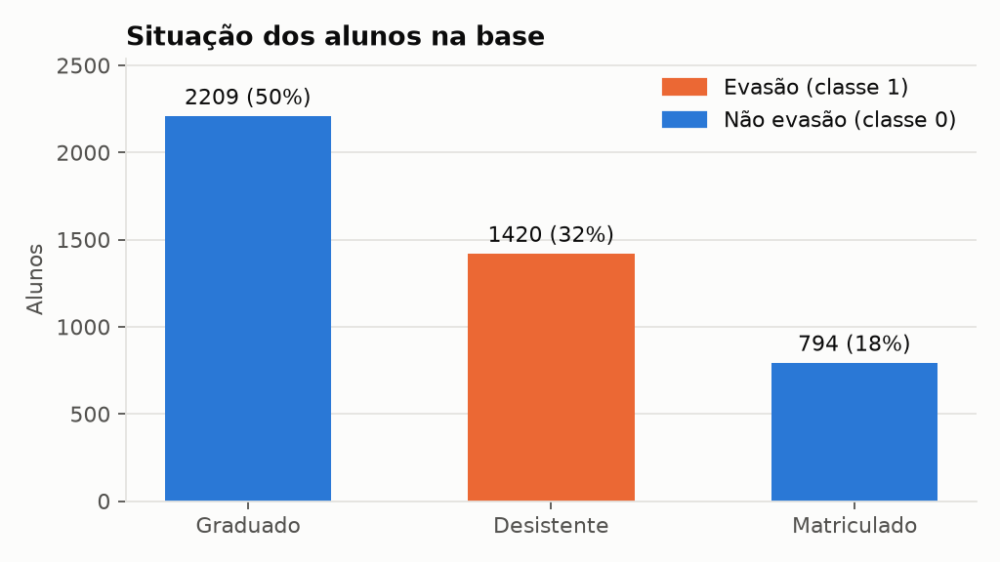
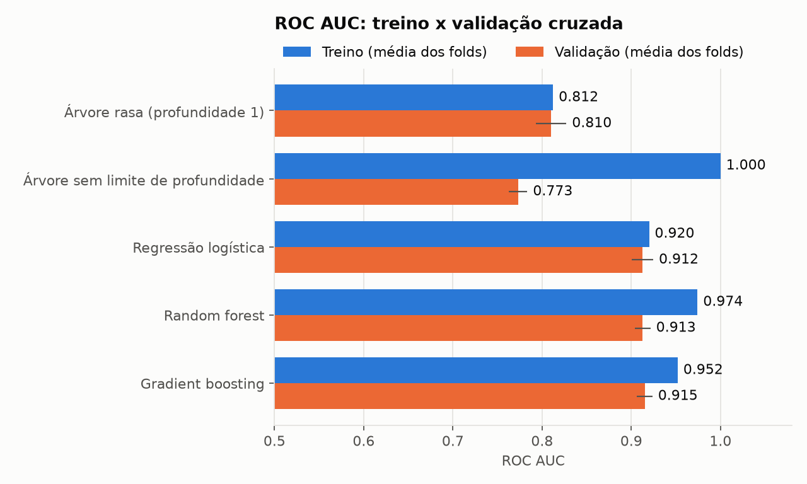
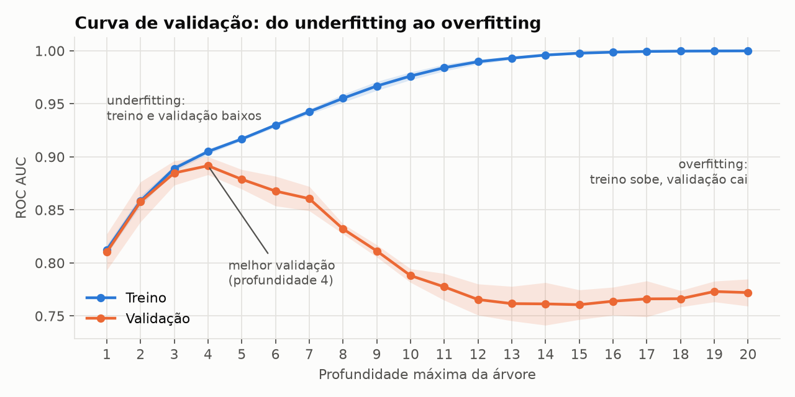
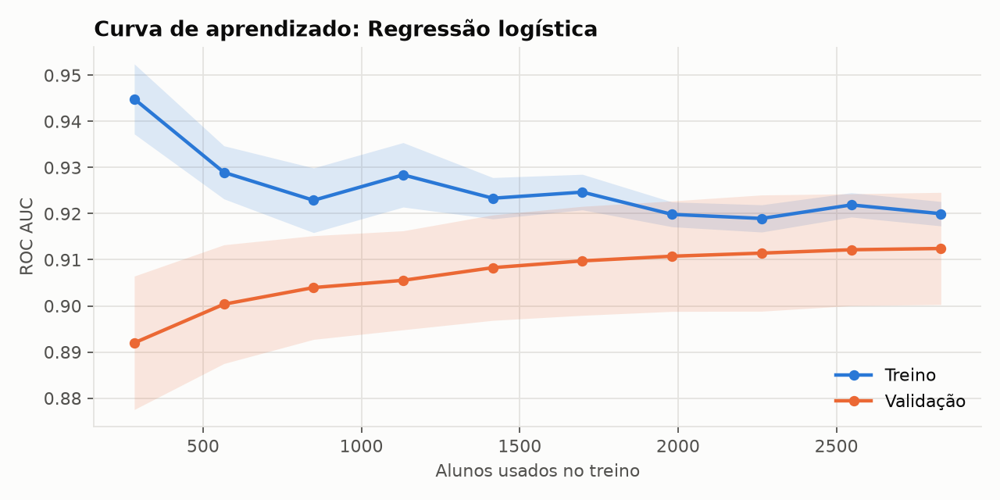
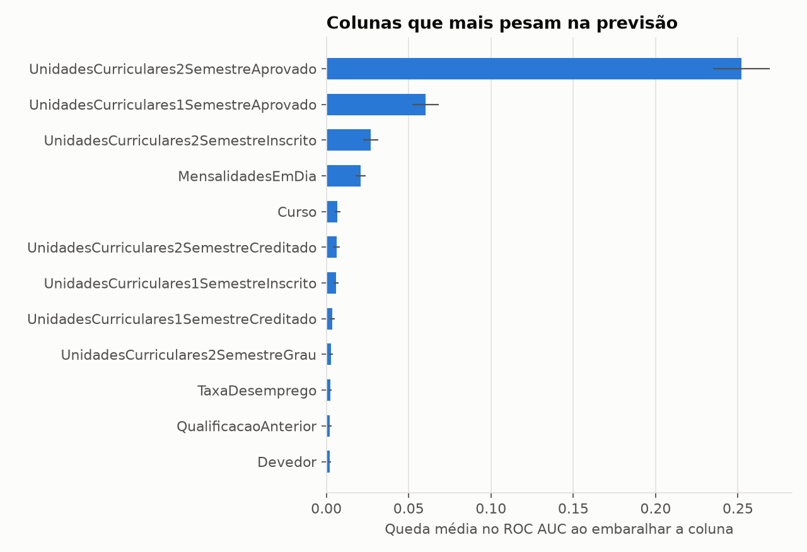
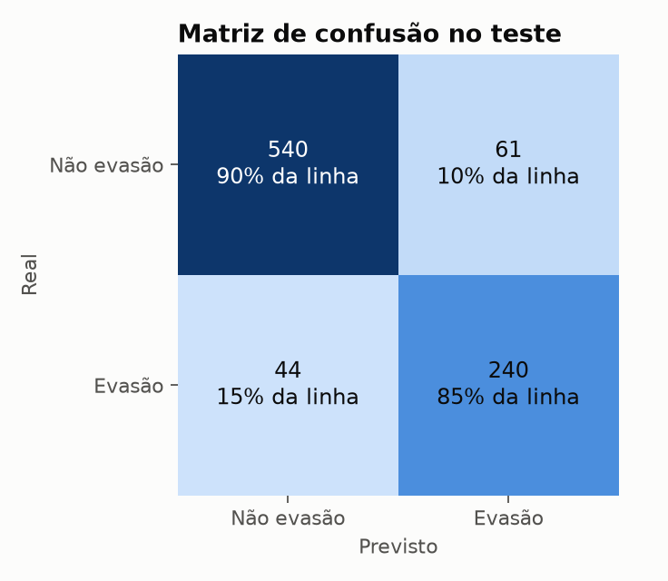
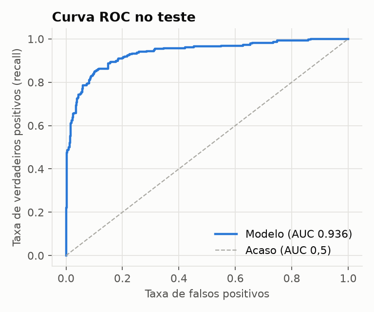

# Previsão de evasão de estudantes

Prova substitutiva da Fase 3 de Machine Learning Engineering (FIAP). O projeto treina um modelo binário que prevê se um aluno vai abandonar o curso, a partir do perfil, da situação financeira e do desempenho nos dois primeiros semestres, e publica o modelo em uma aplicação Streamlit.

- **Aplicação**: https://mlet-fase3-evasao-ygtgwayrwp6duewmwqgklc.streamlit.app/
- **Vídeo**: _link após a gravação_
- **Análise passo a passo**: [`notebooks/analise_evasao.ipynb`](notebooks/analise_evasao.ipynb)



## Resultado

O modelo escolhido é uma regressão logística. No conjunto de teste (885 alunos que não participaram de nenhuma etapa do treino):

| ROC AUC | Recall | Precisão | F1 | Acurácia |
|---|---|---|---|---|
| 0,936 | 0,845 | 0,797 | 0,821 | 0,881 |

De 284 alunos que evadiram, o modelo sinalizou 240. De 601 que não evadiram, 61 foram sinalizados sem necessidade.

## Passos desenvolvidos

### 1. Qualidade dos dados

A base (`data/raw/StudentsPrepared.xlsx`) tem 4.424 alunos, 27 variáveis explicativas e a coluna `Target`. Não há valores nulos, mas dois problemas precisaram de tratamento:

- **Notas sem o separador decimal.** As duas colunas de nota média por semestre deveriam estar entre 0 e 20, mas cerca de 40% das linhas vieram sem a vírgula: `13,875` aparece como `13875` e `13,666...` como `1,36e16`. O reparo divide cada valor acima de 20 pela potência de 10 que o devolve à escala. Depois dele, a nota é 0 exatamente nos alunos sem unidade aprovada, e a menor nota acima de zero fica em 9,8.
- **Uma linha duplicada**, removida para não aparecer no treino e no teste ao mesmo tempo.



### 2. Alvo binário

`Target` tem três situações: Graduado (50%), Desistente (32%) e Matriculado (18%). A classe positiva é **Desistente**; Graduado e Matriculado formam a classe negativa.

A alternativa seria descartar os matriculados e comparar só desistentes com graduados. O problema ficaria mais fácil, mas o modelo seria usado justamente em alunos matriculados, um grupo que ele nunca teria visto.



### 3. Feature engineering

Todo o tratamento fica dentro de um `Pipeline` do scikit-learn (`evasao/model.py`). Cada fold da validação cruzada ajusta imputação, padronização e encoding só com os seus dados de treino.

- **Variáveis derivadas** (`evasao/features.py`): taxa de aprovação (aprovadas / inscritas) e avaliações por unidade em cada semestre, variação da nota e das aprovações entre os semestres, e um indicador para os 180 alunos sem nenhuma unidade inscrita. Os contadores brutos dependem do tamanho da grade de cada curso; as taxas são comparáveis entre cursos.
- **Numéricas**: imputação pela mediana e `StandardScaler`.
- **Categóricas**: `OneHotEncoder`, com as categorias de menos de 20 alunos agrupadas em uma coluna de "raras". Categorias nunca vistas caem nesse mesmo grupo na hora da previsão.
- **Binárias**: seguem como 0/1.
- **`International`** é descartada, porque repete a informação de `Nacionalidade` (é 1 sempre que a nacionalidade não é "Português").

As 27 colunas de entrada viram 63 depois do tratamento.

### 4. Treino e teste

Separação estratificada de 80/20: 3.538 alunos no treino e 885 no teste, os dois com 32,1% de evasão. O teste só é usado uma vez, para medir o modelo final.

### 5. Validação cruzada

Dentro do treino, cada candidato passa por um `GridSearchCV` com `StratifiedKFold` de 5 folds, guardando as métricas de treino e de validação. Como a evasão é 32% da base, os modelos usam `class_weight="balanced"` e a comparação é feita por ROC AUC, com F1 e recall como apoio.

| Modelo | AUC treino | AUC validação | Diferença | F1 validação | Recall validação |
|---|---|---|---|---|---|
| Árvore rasa (profundidade 1) | 0,812 | 0,810 | 0,002 | 0,731 | 0,826 |
| Árvore sem limite de profundidade | 1,000 | 0,773 | 0,227 | 0,691 | 0,701 |
| **Regressão logística** (`C=0.1`) | 0,920 | 0,912 | 0,008 | 0,779 | 0,799 |
| Random forest (`min_samples_leaf=5`) | 0,974 | 0,913 | 0,061 | 0,779 | 0,801 |
| Gradient boosting (`max_depth=3`, 100 iterações) | 0,952 | 0,915 | 0,037 | 0,789 | 0,801 |



Regressão logística, random forest e gradient boosting empatam na validação: ficam entre 0,912 e 0,915, com desvio de 0,01 entre os folds. A seleção segue a regra de um erro padrão: entre os candidatos que empatam com o melhor, fica o de menor diferença entre treino e validação. Esse critério escolhe a regressão logística.

## Houve overfitting ou underfitting?

**Underfitting na árvore rasa.** Com uma única divisão, o AUC é 0,812 no treino e 0,810 na validação. Os dois valores são quase iguais e ficam 0,10 abaixo dos melhores modelos: falta capacidade para capturar o padrão.

**Overfitting na árvore sem limite.** O AUC chega a 1,000 no treino e cai para 0,773 na validação, abaixo até da árvore rasa. A árvore decorou os alunos do treino.

A curva de validação mostra a passagem de um caso para o outro na mesma árvore. Até a profundidade 4, treino e validação sobem juntos. Depois disso o treino segue até 1,0 e a validação cai de 0,89 para 0,77.



**Overfitting leve nos conjuntos de árvores.** A random forest e o gradient boosting generalizam bem, mas carregam de 0,04 a 0,06 de diferença entre treino e validação.

**Ajuste adequado na regressão logística.** O AUC é 0,920 no treino, 0,912 na validação e 0,936 no teste. A diferença entre treino e validação é de 0,008, e o desempenho no teste não caiu. O teste ficou um pouco acima da validação porque é uma amostra única de 885 alunos; a diferença (0,024) equivale a dois desvios entre os folds.

A curva de aprendizado confirma: com mais alunos, treino e validação convergem para perto de 0,92. A validação quase não sobe nos últimos pontos, então mais linhas do mesmo tipo trariam pouco ganho.



## Conclusões

1. O desempenho no 2º semestre é o que mais pesa na previsão, seguido da situação das mensalidades. Entre os alunos com mensalidade atrasada, 87% evadem; entre os demais, 25%.
2. Um modelo linear com regularização alcança o mesmo desempenho de validação dos conjuntos de árvores, com menos overfitting e com coeficientes que explicam cada previsão. A aplicação usa esses coeficientes para mostrar o que pesou em cada caso.
3. O modelo identifica 85% dos alunos que evadem, com 80% de precisão.
4. As variáveis mais fortes só existem depois do 2º semestre. O modelo serve para acompanhar alunos em curso, e não para prever evasão na matrícula.
5. O score vem de um modelo com pesos balanceados entre as classes. Ele ordena bem os alunos por risco, mas não é uma probabilidade calibrada. A troca foi ganhar recall na classe de evasão em vez de calibração.



| Matriz de confusão | Curva ROC |
|---|---|
|  |  |

## Aplicação

`app.py` carrega o pipeline salvo em `models/model.joblib` e tem quatro abas:

- **Previsão individual**: formulário com os dados de um aluno, score de risco e os fatores que mais pesaram. Três alunos do conjunto de teste servem de exemplo.
- **Previsão em lote**: recebe uma planilha no formato da base, corrige as notas e devolve as previsões em CSV.
- **Desempenho do modelo**: métricas de teste, tabela da validação cruzada e a análise de overfitting e underfitting.
- **Sobre**: resumo do problema, da base e dos limites do modelo.

## Estrutura

```
app.py                      aplicação Streamlit
evasao/
  schema.py                 nomes de colunas e caminhos
  data.py                   leitura, reparo das notas e alvo binário
  features.py               variáveis derivadas (transformador do pipeline)
  model.py                  pré-processamento e candidatos
  train.py                  validação cruzada, seleção, avaliação e artefatos
  predict.py                funções de previsão usadas pelo app
  plots.py                  gráficos
models/
  model.joblib              pipeline treinado
  metadata.json             métricas, hiperparâmetros e opções do formulário
notebooks/analise_evasao.ipynb
tests/                      35 testes (dados, features, modelo e app)
requirements.txt            dependências da aplicação no Streamlit Cloud
```

## Rodando

Requisitos: Python 3.12 e Poetry.

```bash
poetry install
poetry run pytest
poetry run python -m evasao.train
poetry run streamlit run app.py
```

`evasao.train` refaz a validação cruzada, grava `models/model.joblib`, `models/metadata.json` e os gráficos em `docs/figures/`. O resultado é reproduzível (`random_state=42`).

Para executar o notebook:

```bash
cd notebooks && poetry run jupyter nbconvert --to notebook --execute --inplace analise_evasao.ipynb
```

## Deploy

A aplicação roda no Streamlit Community Cloud, apontando para `app.py` na branch `main`, com Python 3.12. O Streamlit Cloud instala as dependências de `requirements.txt`, que fixa as mesmas versões usadas no treino. Um teste garante que a versão do scikit-learn em `requirements.txt` é a mesma que gerou o modelo salvo.
